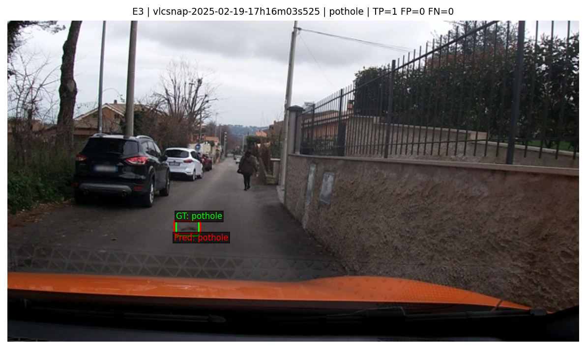
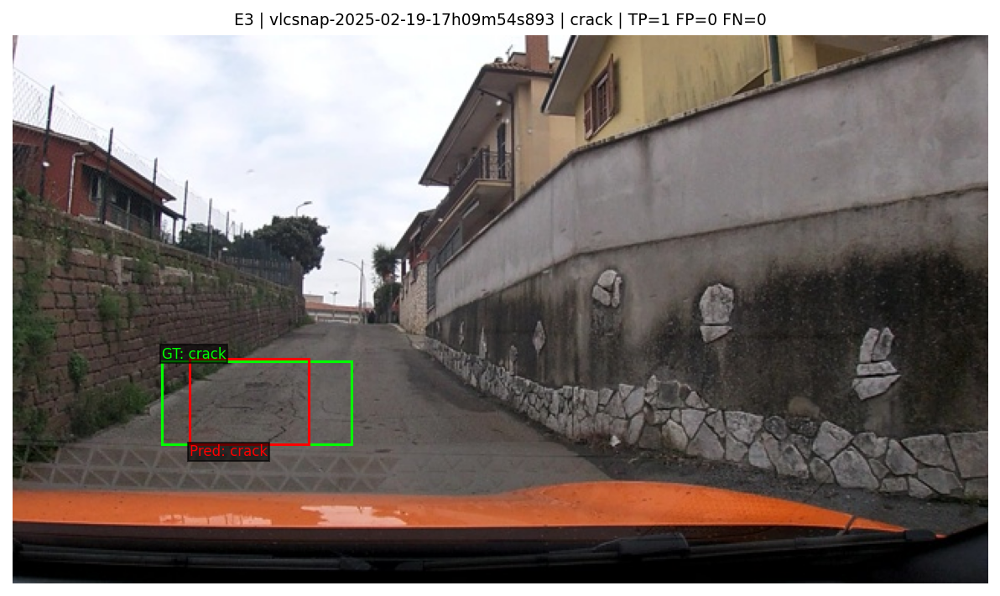
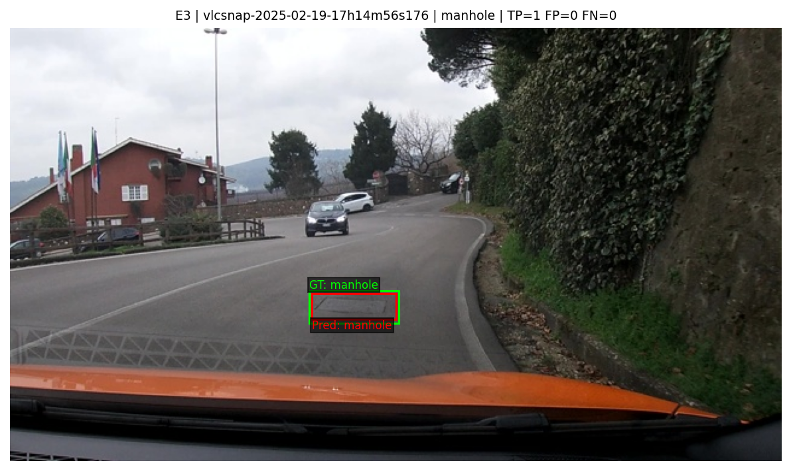
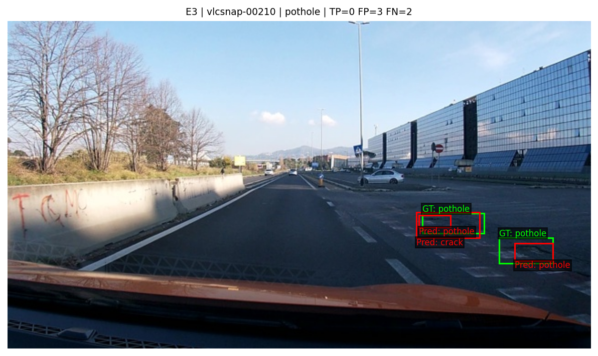
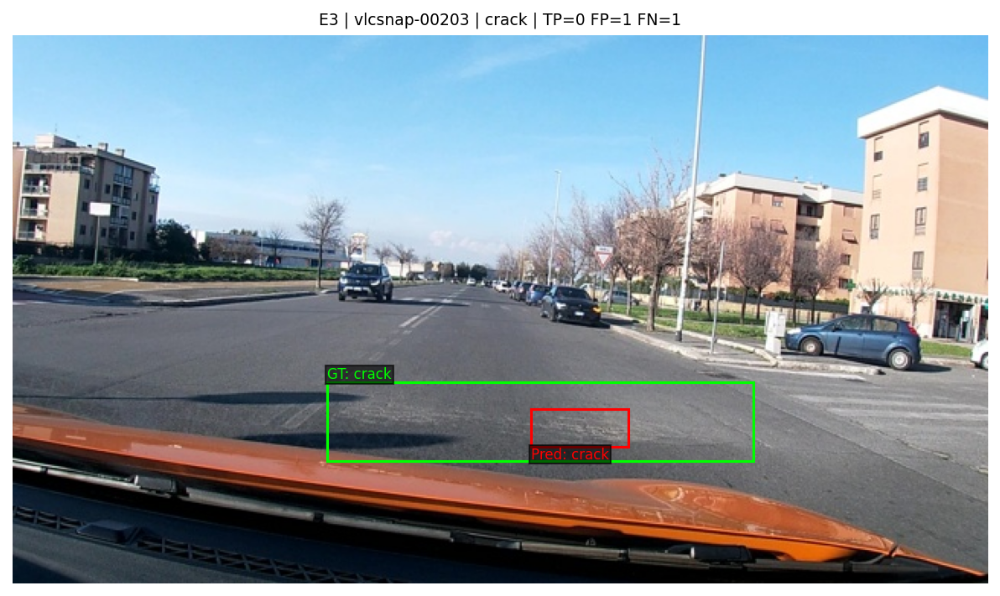
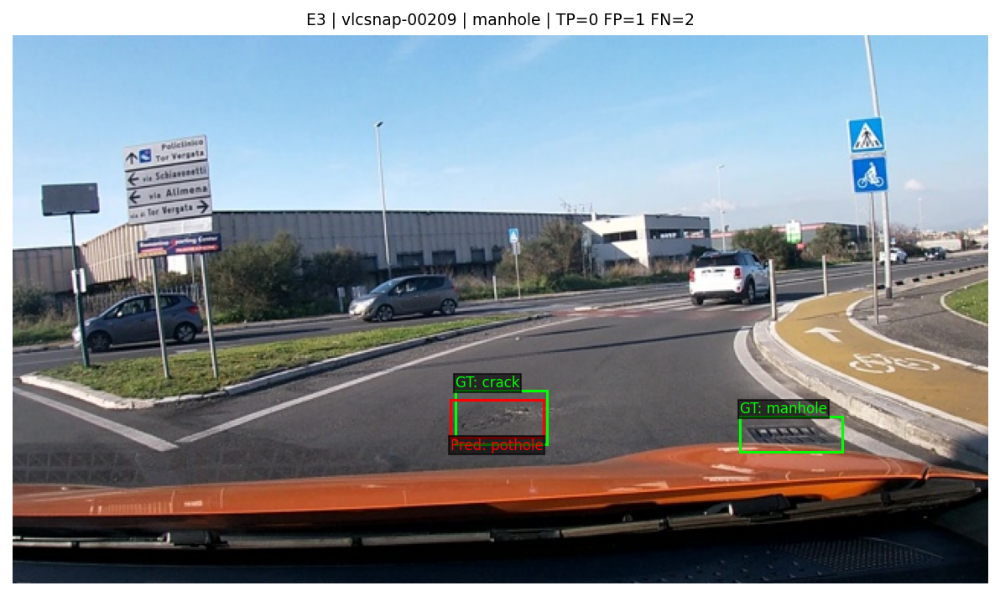

Họ tên: Tống Trần Tiến Dũng
`dataset_version`: d10-21e4070301

## Bảng tổng hợp (số của bạn, lấy từ `report/evidence/*.json`)

| Mã | Setup | Tham số huấn luyện | VRAM đỉnh (GB) | Phút | F1 | CI95 | FP/ảnh | F1 pothole | F1 crack | F1 manhole |
|---|---|---|---|---|---|---|---|---|---|---|
| E0 | zero-shot | 0 | 3,7785 | 10,3079 | 0,1005 | [0,0738; 0,1292] | 0,9807 | 0,1310 | 0,0271 | 0,2311 |
| E1 | LoRA LLM | 33.030.144 | 6,4353 | 38,6841 | 0,2648 | [0,2267; 0,3038] | 1,1801 | 0,1579 | 0,1988 | 0,5179 |
| E2 | + projector | 142.135.296 | 8,1285 | 39,7675 | 0,3306 | [0,2899; 0,3706] | 1,0804 | 0,1947 | 0,2689 | 0,5887 |
| E3 | + LoRA ViT | 148.426.752 | 8,3067 | 48,1279 | 0,4569 | [0,4197; 0,4991] | 0,9486 | 0,3014 | 0,4071 | 0,6780 |
| E4 | (ghi biến và giá trị) | | | | | | | | | |

## 10 câu hỏi (trả lời bằng **số của bạn**, không chép lại tài liệu)

### Câu 1 — Kiến trúc: ViT, projector và LLM của Qwen3-VL-4B có bao nhiêu tham số mỗi khối, và E1/E2/E3 mỗi cái cập nhật khối nào?
Tôi đếm trên cây Qwen3-VL-4B-Instruct thật, dùng model trên thiết bị meta để không nhầm số phần tử storage NF4 với số tham số kiến trúc. Tổng model gốc là 4.437.815.808 tham số; LLM cùng embedding có 4.022.468.096. Khối visual tổng cộng 415.347.712, gồm backbone ViT 306.242.560 và projector 109.105.152 (merger 27.271.680; ba deepstack merger cộng 81.833.472).

| Setup | Phần cập nhật | Module LoRA | Tham số huấn luyện đo trên T4 |
|---|---|---:|---:|
| E1 | LoRA attention/MLP của LLM; embedding, lm_head, ViT và projector đóng băng | 252 | 33.030.144 |
| E2 | E1 và toàn bộ merger/deepstack merger | 252 | 142.135.296 |
| E3 | E2 và LoRA attention/MLP của ViT | 348 | 148.426.752 |

E2 − E1 = 109.105.152, đúng bằng số tham số projector. E3 thêm 96 module LoRA vision và 6.291.456 tham số; đây là LoRA trên ViT, không mở toàn bộ trọng số ViT.

### Câu 2 — E0: `parse_valid_rate` bằng bao nhiêu, và hai lỗi phổ biến nhất của model gốc là gì (kèm một ví dụ output thô)?
E0 có parse_valid_rate = 300/311 = 96,4630%; đủ 311 dự đoán, không thiếu ảnh. F1 = 0,1005, precision = 0,1335, recall = 0,0806; có 47 TP, 305 FP và 536 FN. Hai lỗi nổi bật là bỏ sót hư hại và định vị box quá rộng/lệch vị trí: 11 ảnh trả `[]` dù có GT, còn crack chỉ có 7 TP nhưng 210 FP và 292 FN. Ví dụ output thô của `vlcsnap-00203` là `[{"label":"crack","bbox_2d":[0, 457, 1000, 999]}]`; GT crack là khoảng [321,875; 630,556; 759,375; 775,000], nên box gần phủ cả nửa dưới ảnh không đạt IoU 0,5. Với `vlcsnap-00200`, output `[{"label":"manhole","bbox_2d":[759, 634, 845, 687]}]` vừa bỏ sót crack vừa lệch khỏi manhole thật. Năm output đầu không bọc markdown và không có chữ thừa. Có 11 output không parse được, là nhóm riêng với 11 output `[]` hợp lệ nêu trên; ví dụ `vlcsnap-2025-02-18-23h12m24s456` kết thúc dở ở khoá `"bbox_`, nên JSON không hoàn chỉnh.

E0 dùng Tesla T4: VRAM đỉnh 3,7785 GiB, thời gian suy luận 10,3079 phút, đo bằng torch.cuda.max_memory_allocated và perf_counter trong cell E0. Cột Phút của E0 là suy luận; các thí nghiệm huấn luyện sẽ ghi thời gian train.

### Câu 3 — Thang 0–1000: nếu chấm output theo pixel (hoặc ngược lại) thì F1 ra sao và vì sao? Bạn đã kiểm chứng điều này thế nào?
Cùng 311 output E0, chấm đúng `coord="norm1000"` cho F1 = 0,1005; gọi evaluate của scripts.score với `coord="pixel"` cho F1 = 0,0000. Tôi giữ nguyên ảnh, nhãn và output, chỉ đổi cách diễn giải toạ độ để kiểm chứng. Ví dụ x = 1000 theo norm1000 là mép phải ảnh 640 pixel; nếu coi là 1000 pixel rồi đổi lại về norm1000, nó thành 1562,5. Với trục y, 1000 pixel thành 2777,8 trên ảnh cao 360 pixel. Box bị phóng to/dịch vị trí nên không đạt IoU 0,5. Thang 0–1000 mô tả vị trí tương đối độc lập độ phân giải; bước quy ngược toàn bộ nhãn đã đo sai số làm tròn tối đa 0,32 pixel và vẽ hai bộ box chồng nhau.

### Câu 4 — Mask loss: vì sao chỉ tính loss trên phần trả lời? Điều gì xảy ra nếu tính trên cả prompt và token ảnh?
Tôi kiểm tra trên Colab T4: ảnh 640×360 có đúng 220 token ảnh và toàn bộ labels tại token ảnh đều bằng -100. Giải mã riêng các token được tính loss cho JSON GT của ví dụ đầu tiên (9 box) rồi kết thúc bằng `<|im_end|>`; tôi cũng assert chuỗi prompt là tiền tố chính xác của hội thoại đầy đủ. Batch hai ảnh có input_ids/labels/attention_mask/mm_token_type_ids cùng shape (2,585), pixel_values (1760,1536) và image_grid_thw (2,3); padding của labels là -100.

Mục tiêu là học P(JSON đáp án | ảnh, prompt), nên loss chỉ tính trên đáp án và token kết thúc. Prompt và token ảnh là điều kiện đã cung cấp, không phải nội dung cần dự đoán. Nếu tính loss trên cả prompt/220 token ảnh, phần cố định có thể chiếm nhiều vị trí, làm loss giảm nhờ học lặp lại mẫu hội thoại và placeholder ảnh thay vì học box/lớp. Điều đó làm loss tổng khó diễn giải và phân tán cập nhật khỏi nhiệm vụ grounding; tôi không chạy đối chứng unmasked nên không gán một mức giảm F1 cụ thể cho lỗi này.

### Câu 5 — Vì sao không thể huấn luyện đầy đủ projector nếu ViT bị lượng tử hoá 4-bit, và bạn đã xử lý thế nào? Vì sao projector phải ở float32?
Trước khi gắn LoRA, tôi assert không có Linear4bit nào trong visual hoặc lm_head. Runtime Transformers 5.19 ban đầu vẫn lượng tử hoá visual khi chỉ truyền tên ngắn `visual`; tôi sửa danh sách bỏ qua thành ["visual","model.visual","lm_head"] theo tên đầy đủ của model. ViT/projector nền giữ fp16, còn 109.105.152 tham số projector của E2/E3 được chuyển float32 và mở requires_grad; kiểm tra dtype/đóng băng đã qua trên cả ba setup.

Trọng số 4-bit được lưu dạng mã lượng tử cùng hệ số scale, không phải từng trọng số float độc lập để AdamW cập nhật đầy đủ. Gắn LoRA vẫn có thể học các ma trận bổ sung, nhưng không thay thế yêu cầu học toàn bộ projector của E2/E3. Projector float32 giữ gradient và cập nhật nhỏ đủ chính xác; GradScaler của vòng lặp này cũng không unscale gradient fp16. Tôi giữ các tham số LoRA học được ở float32 và dùng autocast fp16 cho phép tính, còn LLM nền NF4 đóng băng. Khi lưu E2/E3, notebook lưu riêng merger/deepstack merger vào extra_trainable.pt vì adapter PEFT không chứa các trọng số projector được mở trực tiếp. E3 còn cần gỡ torchao 0.10 có sẵn (không dùng trong lab) để PEFT 0.21.2 gắn LoRA vào các lớp vision thông thường.

### Câu 6 — Split theo phiên quay: vì sao chia ngẫu nhiên sẽ cho F1 cao giả? Số ảnh và số box từng lớp ở mỗi split là bao nhiêu?
Dữ liệu gồm các frame cắt từ video, nên các frame gần nhau thường cùng mặt đường, ánh sáng và vị trí hư hại. Chia ngẫu nhiên có thể đưa các ảnh gần trùng vào cả train và test; mô hình nhận lại cảnh đã học khiến F1 cao giả và không phản ánh khả năng tổng quát sang phiên quay khác. Tôi dùng split cố định do prepare_data.py sinh và kiểm tra giao tập session của train/val/test đều rỗng.

| Split | Ảnh | pothole | crack | manhole |
|---|---:|---:|---:|---:|
| train | 1422 | 1074 | 1750 | 691 |
| val | 276 | 66 | 470 | 103 |
| test | 311 | 121 | 299 | 163 |

Các số được đo lại trên dataset_version d10-21e4070301. Tôi đếm được 13 giá trị session ở train, 2 ở val và 3 ở test. Với tên ảnh chỉ có số, trọng tài định nghĩa session bằng số thứ tự chia nguyên cho 50; đây là cách gom do đề quy định, chưa chứng minh mỗi nhóm là một phiên quay vật lý độc lập. Tôi giữ nguyên split và chỉ xác nhận các giá trị session không giao nhau. Tập val chỉ có 66 box pothole, so với 470 crack và 103 manhole; vì vậy cần đọc F1 từng lớp thay vì chỉ nhìn F1 micro. Có một box crack trong train với chiều cao bằng 0; notebook thông báo và bỏ box suy biến khỏi đáp án SFT, còn dữ liệu/split và GT của trọng tài giữ nguyên.

### Câu 7 — So sánh E1/E2/E3: mở projector và LoRA trên ViT có đáng không (F1, CI95, VRAM, thời gian)?
E1 tăng F1 từ 0,1005 của E0 lên 0,2648 (tăng 0,1643), JSON hợp lệ 100% và không thiếu ảnh. E2 mở thêm 109.105.152 tham số projector, đạt F1 0,3306: tăng 0,0658 so với E1, đổi lại VRAM tăng 1,6932 GiB và thời gian train tăng 1,0834 phút. E3 thêm LoRA ViT đạt F1 0,4569: tăng 0,1263 so với E2, VRAM chỉ tăng 0,1782 GiB nhưng thời gian tăng 8,3604 phút. E3 dùng nhiều VRAM nhất (8,3067 GiB) vì có gradient qua ViT và tham số/gradient/trạng thái AdamW float32 của projector; gradient checkpointing giúp giới hạn activation cần lưu. Cột GB giữ tên của mẫu, nhưng số đo thực tế là GiB (số byte chia 2**30).

Trong ngân sách T4 của lượt chạy này, E3 là lựa chọn đáng nhất: 48,1279 phút và 8,3067 GiB cho F1 cao hơn rõ rệt, FP/ảnh giảm còn 0,9486, so với 1,1801 của E1 và 1,0804 của E2. Nếu cần mức VRAM thấp nhất thì E1 chỉ dùng 6,4353 GiB; E2 cải thiện chất lượng với thời gian gần E1 nhưng cần thêm bộ nhớ do mở đầy đủ projector.

CI95 của E1/E2 là [0,2267; 0,3038] và [0,2899; 0,3706], có chồng lấn; chồng lấn không tự chứng minh hai setup tương đương. Tôi bootstrap ghép cặp 1.000 lần, seed 0, lấy cùng chỉ số ảnh cho mỗi model và dùng TP/FP/FN của trọng tài: CI95 của chênh lệch E2−E1 là [0,0248; 0,1041], còn E3−E2 là [0,0864; 0,1686]; cả hai đều trên 0. CI của E3 [0,4197; 0,4991] cũng tách khỏi E2. Kết luận này áp dụng cho các checkpoint và bộ ảnh hiện tại, với giới hạn ở Câu 8. E4 chọn E3 bằng validation (E1: 0,2281; E2: 0,3031; E3: 0,3820), không đổi lựa chọn dựa trên test.

### Câu 8 — Tập test có 311 ảnh: khoảng tin cậy rộng thế nào, và điều đó giới hạn kết luận so sánh các setup ra sao?
Trọng tài bootstrap 1.000 lần theo ảnh. Độ rộng CI95 của E0/E1/E2/E3 lần lượt là 0,0554; 0,0770; 0,0808; 0,0794, tương đương khoảng 5,54–8,08 điểm phần trăm F1. Ví dụ E3 có F1 0,4569 nhưng CI [0,4197; 0,4991]; một chênh lệch nhỏ vài điểm không đủ để kết luận nếu chỉ nhìn số F1 đơn lẻ. Tôi kiểm tra chênh lệch bằng bootstrap ghép cặp trên cùng ảnh, đồng thời xác nhận CI riêng từng model tính lại từ dự đoán khớp chính xác file evidence.

311 ảnh test chỉ thuộc ba giá trị session: num-4 có 15 ảnh, vlc-2025-02-18-23 có 213 và vlc-2025-02-19-17 có 83. Trọng tài lấy mẫu lại theo ảnh, trong khi các frame cùng video có thể tương quan, nên CI này có thể quá lạc quan khi dự đoán khả năng tổng quát sang phiên quay mới. CI cũng không đo biến động giữa các seed huấn luyện; tôi mới chạy một seed 42 cho mỗi setup. Tôi giữ nguyên cách chấm của đề và không coi 311 frame là 311 phiên quay độc lập.

### Câu 9 — Phân tích lỗi theo lớp: lớp nào kém nhất và vì sao (kích thước box, số mẫu, ngữ nghĩa)? Kèm ảnh minh hoạ.
Ở E3 (SFT được chọn bằng validation), pothole kém nhất: F1 = 0,3014, 33 TP/65 FP/88 FN, recall chỉ 0,2727. Crack đạt F1 0,4071 (127 TP/198 FP/172 FN); manhole đạt 0,6780 (100 TP/32 FP/63 FN). Crack vẫn đóng góp nhiều FP nhất. Thứ tự khác E0, nơi crack thấp nhất (0,0271), nên không thể coi một lớp luôn kém nhất ở mọi setup.

Box pothole trên test có diện tích trung vị 0,4193% ảnh và cạnh ngắn trung vị 22 pixel; manhole là 0,6688%/24 pixel, crack là 1,9813%/49 pixel. Pothole nhỏ, ít tương phản và có thể giống mảng vá/bóng tối; lệch vài pixel có thể làm IoU xuống dưới 0,5. Crack có bbox lớn hơn nhưng tín hiệu vết nứt mảnh, nhiều nhánh và bbox chứa nhiều nền, nên khó chọn đúng phạm vi. Đây là lý giải từ thống kê và ảnh quan sát, không phải kết luận nhân quả từ một ablation riêng. Số mẫu không giải thích toàn bộ: train có 1.074 box pothole, nhiều hơn 691 manhole, nhưng F1 vẫn thấp hơn; val cũng chỉ có 66 pothole so với 470 crack.

Sáu ảnh dưới dùng GT xanh, dự đoán đỏ; TP/FP/FN trong tiêu đề là tổng của ảnh. Ba ảnh đầu có TP=1, FP=0, FN=0 cho từng lớp. Hình 4 (`vlcsnap-00210`) có hai GT pothole nhưng các box dự đoán lệch/phạm vi không khớp, đồng thời có crack thừa: TP=0, FP=3, FN=2. Hình 5 (`vlcsnap-00203`) đoán đúng lớp crack nhưng box quá hẹp so với GT: TP=0, FP=1, FN=1. Hình 6 (`vlcsnap-00209`) gọi vùng crack là pothole và bỏ sót manhole ở bên phải: TP=0, FP=1, FN=2.

Hình 1 — pothole khớp.

Hình 2 — crack khớp.

Hình 3 — manhole khớp.

Hình 4 — pothole chưa đạt IoU, có box thừa.

Hình 5 — bbox crack quá hẹp.

Hình 6 — sai lớp và bỏ sót manhole.

### Câu 10 — E4: bạn đổi biến nào, kết quả thế nào, và kết luận có đáng tin không?
<điền>

## Nhìn lại

E1/E2/E3 đã chạy đủ 300 bước tối ưu trên T4, cả 900 giá trị loss đều hữu hạn. Loss trung bình 20 bước đầu → 20 bước cuối lần lượt là 0,8308 → 0,5676; 0,8113 → 0,5224; 0,8126 → 0,4847. Loss có dao động giữa các batch, nên tôi đánh giá bằng suy luận từ checkpoint đã nạp lại đầy đủ, thay vì suy ra F1 từ loss. Kết quả test E1/E2/E3 lần lượt là 0,2648/0,3306/0,4569.

Tôi gặp lỗi visual bị lượng tử hoá ngoài ý muốn, lỗi tương thích torchao và một box train cao bằng 0. Các assert về dtype, module LoRA, mask và nhãn suy biến phát hiện được những lỗi này trước huấn luyện. Điều còn cần kiểm chứng là mức tổng quát sang phiên quay vật lý mới và độ ổn định giữa nhiều seed; giao tập session rỗng và CI theo ảnh chưa trả lời được hai vấn đề đó.

Phiên Colab cũ bị ngắt trong lúc chấm E1–E3 và tài khoản cũ chạm giới hạn GPU. Tôi chuyển sang T4 của tài khoản khác, chuyển lại ba bản sao đầy đủ và kiểm tra SHA256 của từng gói khớp bản gốc. Không huấn luyện lại E1/E2/E3; thời gian, VRAM và loss giữ nguyên từ lượt train ban đầu. Tôi nạp lại model gốc, adapter và extra_trainable.pt của E2/E3, chấm đủ 276 ảnh val và 311 ảnh test mỗi setup rồi tải ngay dự đoán/evidence về máy. Kết quả dang dở của phiên cũ không được dùng để chọn setup hay điền số. E0 giữ nguyên 311 dự đoán cũ; chấm lại cùng dự đoán chỉ để đồng bộ metadata/output notebook, và đã assert F1/CI/TP-FP-FN không đổi.

Cả ba adapter cùng run.json đã sao lưu trong thư mục lab_day10 trên Google Drive. Bản sao Drive chỉ chứa adapter và metadata; khôi phục E2/E3 cần thêm projector từ e2_backup.tar.gz/e3_backup.tar.gz đầy đủ trên máy. Sau khi đổi tài khoản, tôi xác nhận dataset_version vẫn là d10-21e4070301, giữ nguyên split của đề và chỉ dùng validation để chọn E3 làm gốc cho E4.
